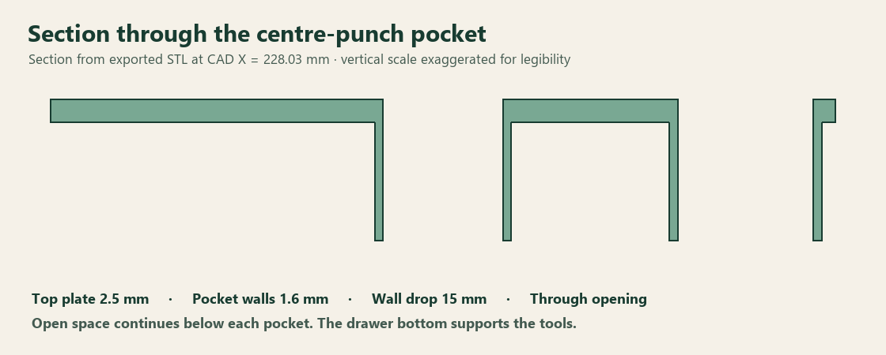
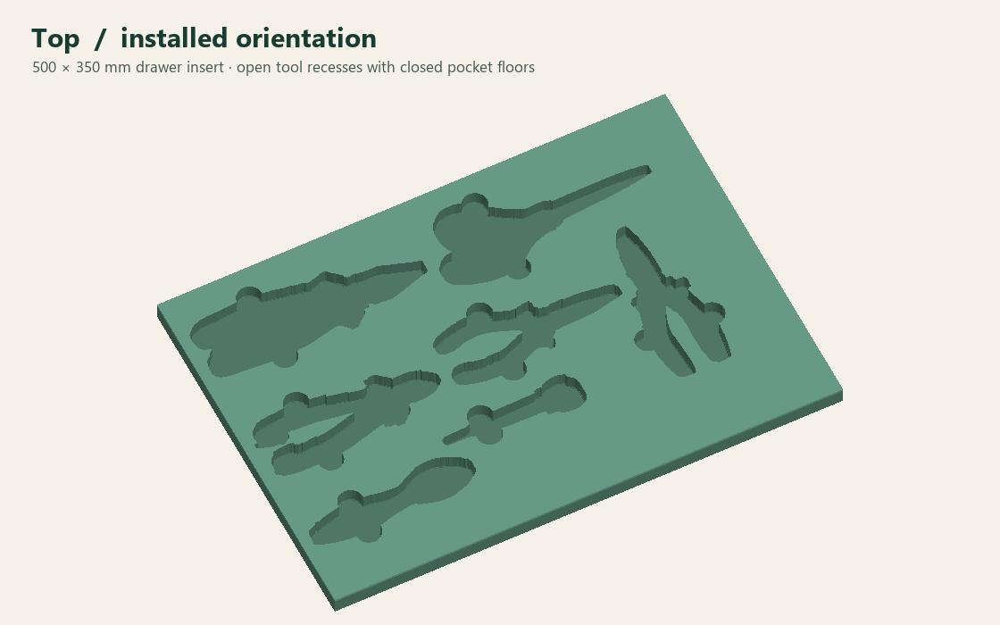
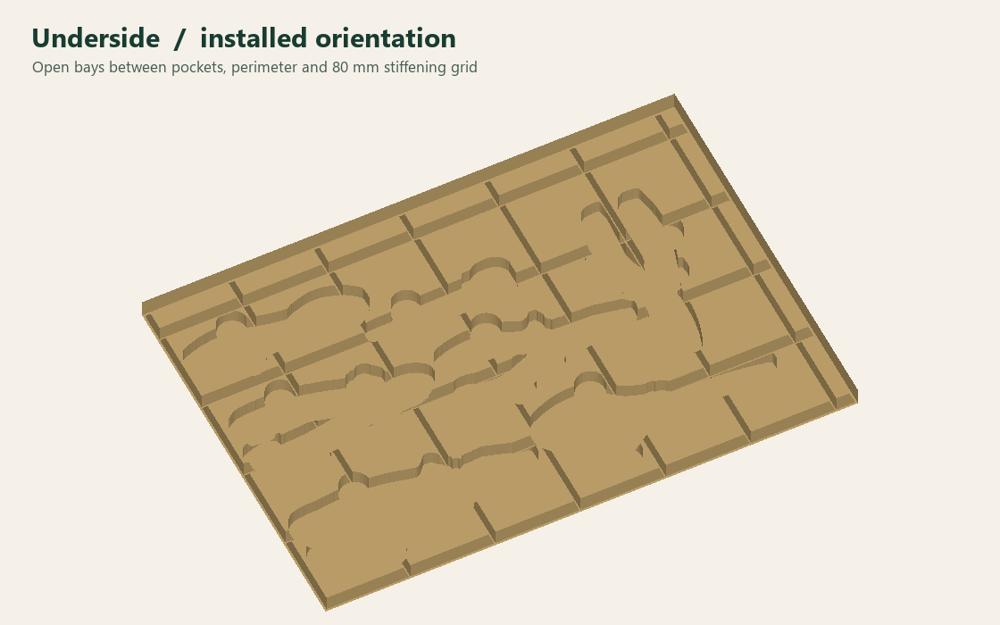
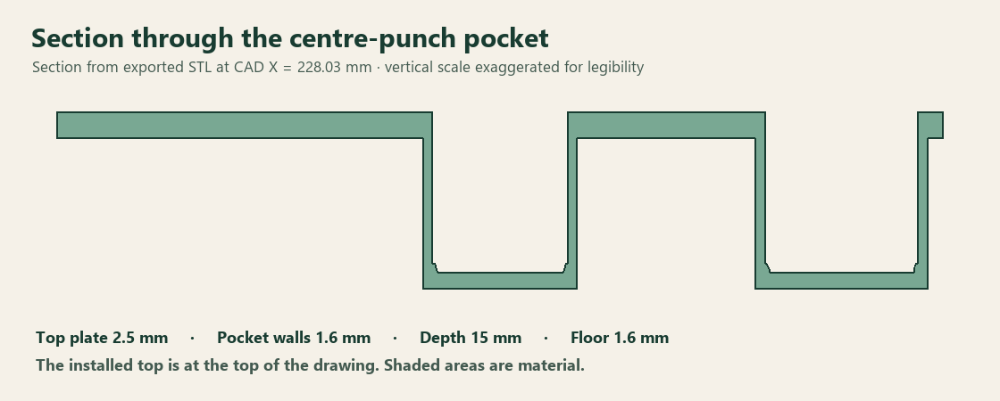

# Through-hole follow-up

The current export removes material through the entire tool opening. The tool walls still hang below the 2.5 mm top plate. The drawer bottom supports the tools after the insert is flipped into its installed position.

On the saved 500 × 350 mm layout, an independent scan of the actual STL facets found zero blocking area inside the tool openings on the whole board and all six tiles. Trimesh and PyMeshLab found one watertight volume and zero self-intersecting faces per part. STL-to-DXF opening IoU was 0.999986 for the board and 0.957635–0.987987 for the tiles. The app estimates 489 g for the board and 581 g for six tiles.

[Through-hole mesh audit](verification/through-hole/independent-audit.json)

# Earlier verification with pocket floors

The installed board has a 2.5 mm perforated top, 1.6 mm pocket walls and floors, and a 2 mm full-height perimeter. The open bays are reinforced with 1.2 mm ribs on an 80 mm grid by default. The printable STL puts the top on Z=0 and preserves the DXF XY orientation. Nominal cavity depth is tool thickness plus 1 mm, clamped between the plate thickness and the space available above the floor. The saved test layout uses a nominal 14 mm tool thickness and 15 mm pocket depth. Use the export panel's tool-thickness fields for measured values.

The print and laser exports share the opening geometry, including the optional notches. The 12 mm notch circles are centered on existing finger-pull anchors along the pocket edge. Pocket walls follow the resulting opening so the plate stays supported. The default 0.8 mm floor bevel uses a 45° inset along straight edges and adapts on narrow sections. Tile seams reserve the perimeter-wall thickness on both sides, and full-height pads back the dovetails. Each tile label is attached to the underside of the plate.

## Independent mesh validation

The 500 × 350 mm saved seven-tool project exported as one board and six tiles. Trimesh found every board and tile watertight, a positive volume, and one face-connected body. PyMeshLab marked zero intersecting faces in each. IoU compares the independently parsed DXF contours with actual STL cross sections at print Z=0.017 mm. Each tile's reference is the DXF clipped to its footprint **before** seam allowance, which accounts for the lower tile scores.

| Mesh | IoU | Watertight | Positive volume | Bodies | Self-intersecting faces |
|---|---:|:---:|:---:|---:|---:|
| Board | 0.999986 | Yes | Yes | 1 | 0 |
| A1 | 0.986829 | Yes | Yes | 1 | 0 |
| B1 | 0.965963 | Yes | Yes | 1 | 0 |
| C1 | 0.957635 | Yes | Yes | 1 | 0 |
| A2 | 0.987987 | Yes | Yes | 1 | 0 |
| B2 | 0.967109 | Yes | Yes | 1 | 0 |
| C2 | 0.984751 | Yes | Yes | 1 | 0 |

The app also checks the actual STL's bed-face openings against the export contours and blocks a mirrored or open mesh. The test suite probes exact section heights for the deck, rib, perimeter, pocket floor and bevel, and verifies the rib toggle and notch size. The ZIP contains the key and socket clearance coupons as two individual STL files. Each also passes the single-volume and self-intersection checks. See the [independent audit](verification/inverted-shell/independent-audit.json).

## Material and print time

Same saved drawer placement, compared against a1ab267. Both OrcaSlicer 2.5.1 exports use generic PLA (1.24 g/cm³, 12 mm³/s maximum), a 0.4 mm nozzle, 0.2 mm layers, three walls, four top and four bottom layers, 15% gyroid, and supports disabled. The single-piece board uses a custom 550 × 400 mm comparison bed, and C2 uses a 256 × 256 mm comparison bed. The seam planner moved C2's left seam by 8 mm, so its footprint changed from 152 × 200 to 144 × 200 mm.

| Part | App before | App after | Orca 2.5.1 before | Orca 2.5.1 after |
|---|---:|---:|---:|---:|
| 500 × 350 board | 623.97 g / 19.97 h | 603.37 g / 19.31 h | 659.08 g / 35 h 45 m | 611.97 g / 33 h 05 m |
| C2 | 137.57 g / 4.40 h | 117.60 g / 3.76 h | 144.09 g / 9 h 15 m | 119.56 g / 6 h 46 m |

The app estimates deposition at a constant effective 7 mm³/s and substantially underestimates slice time for these profiles. Orca includes toolpath travel, bridge speeds, and acceleration. Orca material fell by 47.11 g (7.1%) for the board and 24.53 g (17.0%) for C2. The cuts were sliced with supports disabled. Physical bridge quality remains untested.

