# Print and capture verification

Baseline: 91d13701d1b56503d5413bc676c4ef65b813104c. Branch: cursor/snapinset-revamp-ae47. No changes to main. Tested in headless local Chrome on Windows on 2026-11-19. Static HTML/CSS/JS, including local dependencies; no application build step.

| Check | Before | After |
|---|---|---|
| STL orientation | Y-mirrored relative to DXF | Whole board + all tiles match; fail-closed centroid/area check |
| B1 topology | User reported 29 open edges; matched-layout rerun found 9 | 0 open edges; one body, including both label glyphs |
| Label failure | Silent skipped label | Visible warning plus zip manifest; geometry errors block zip |
| Material estimates | Matched-layout panel 561 g vs export 820 g | Shared board 624 g; six tiles 810 g; coupon 6.6 g separately |
| Print time | None | Board 20 h; tiles 26 h; warning above 12 h |
| Hard shadow / 40 mm truth | 56.2 mm | 40.4 mm |
| Missing-blade confidence | Edge support could be near 100% | Type/area/aspect/span/tip checks; shortened scissors rejected by auto-accept |
| Height parallax | Paper-plane dimensions only | Explicit warning and optional per-tool measured-span correction |
| Review actions | Could scroll out of view | Sticky footer; checked at 1440×900 and 390×844 |
| Arrange | Stale overlap; always consumed budget | Refresh badges; early success/plateau stop, distinct Tidy/Dense messages |
| Export workflow | Mixed into arrange | Separate step 4; depth in 3D, tool names in DXF preview |
| Fonts/mobile | Google requests, hidden step names/toast obstruction | Local licensed fonts, four visible step names, safe toast placement |
| Project JSON | User reported 7.7 MB | 1,151,912 bytes (1.15 MB); thumbnails optional, source photos omitted |

## Eight original photos

All eight ran automatically, without retouching, manual corners or caliper correction. One contour per photo. Paper corners and zero-clearance dimensions are unchanged from 91d1370. Seven unique tools were explicitly accepted for the print fixture; duplicate B was measured but not placed twice. The given baseline measurements came from the user's prior run, not the current matching-settings run.

| Tool | Supplied before, mm | 91d1370 and current, zero clearance, mm | Current 2 mm pocket, mm | End-to-end photo runtime, s |
|---|---|---|---|---|
| Chrome slip-joint | 160.6 × 40.7 | 159.0 × 39.8 | 163.0 × 43.8 | 2.13 |
| Red/black long-nose | 163.6 × 58.8 | 162.8 × 59.9 | 166.8 × 64.0 | 1.82 |
| INGCO combination | 217.5 × 66.9 | 215.1 × 67.6 | 219.2 × 71.6 | 1.80 |
| INGCO diagonal cutters | 171.6 × 65.5 | 173.6 × 63.0 | 177.8 × 67.2 | 1.64 |
| Red/grey scissors | 119.7 × 84.6 | 210.8 × 83.8 | 214.8 × 87.8 | 1.72 |
| Blue centre punch | 132.5 × 37.6 | 131.7 × 35.0 | 135.8 × 39.2 | 1.70 |
| Yellow long-nose A | 172.2 × 66.3 | 170.4 × 64.9 | 174.4 × 69.0 | 1.60 |
| Yellow long-nose B | 171.6 × 66.6 | 170.8 × 65.0 | 174.8 × 69.0 | 1.54 |

L × W above is the page-axis bounding box, before finger pulls. Caliper input instead measures maximum straight-line span (Feret diameter), e.g. scissors 211.8 mm versus page-axis length 210.8 mm. Clearance is added after scaling. Yellow duplicate difference: 0.40 mm length (0.23%) and 0.14 mm width (0.21%); both default-clearance widths round to 69.0 mm. Scissors: 210.8 × 83.8 mm, one solid contour, no fragments.

## STL and tiles

500 × 350 mm drawer, 18 mm thickness, 15 mm pockets, 2 mm wall/clearance, 14 mm finger-pull radius, 10 mm requested spacing, Bambu A1/P1S 256 × 256 bed with 3 mm margin. Automatic Tidy produced seven placed tools and an 11.16 mm minimum gap. Independent validation loads the actual exported binary STL with trimesh and independently parses the exported DXF with Shapely. It checks both centroid and area, allowing up to 1 mm² seam slivers and 0.15 mm centroid error. Largest observed centroid discrepancy across board and tiles: 0.0234 mm. Original mirrored board fails this test. Built-in checks use the serialized pocket floors and pass within 0.000004 mm; injected mirror, open facet and reversed winding all block export.

| Part | Open edges | Nonmanifold edges | Bodies | Watertight / consistent winding | Label |
|---|---|---|---|---|---|
| board | 0 | 0 | 1 | PASS | n/a |
| tile-A1.stl | 0 | 0 | 1 | PASS | Both glyphs retained |
| tile-B1.stl | 0 | 0 | 1 | PASS | Both glyphs retained |
| tile-C1.stl | 0 | 0 | 1 | PASS | Both glyphs retained |
| tile-A2.stl | 0 | 0 | 1 | PASS | Both glyphs retained |
| tile-B2.stl | 0 | 0 | 1 | PASS | Both glyphs retained |
| tile-C2.stl | 0 | 0 | 1 | PASS | Both glyphs retained |
| clearance-coupon.stl | 0 | 0 | 2 | PASS | n/a |

The coupon intentionally contains two separate mating bodies. Every tile is one body; raised letters are part of that body. All tile bounds fit the usable bed. B1's before count depends on arrangement: the reported 29 and this matched-layout rerun's 9 describe different fixtures. Final zip includes tiles.txt and validation.json. No labels were skipped in this run.

## Material and time

One mesh-based deposition model estimates perimeter bands + top/bottom skins + infill in the remaining volume. The panel, export toast and zip notes consume the same cached result. Defaults: PLA 1.24 g/cm³, 15% infill, three 0.45 mm perimeters, four top/four bottom layers at 0.2 mm, effective flow 7 mm³/s. Board: 623.97 g / 19.97 h. Six tiles: 810.00 g / 25.92 h, excluding coupon 6.64 g / 0.21 h. User's Orca references were 587 g and 740 g; this run is +6.3% and +9.5%, respectively, with layout/settings potentially different. These are approximate deposition estimates (±20% mass, ±35% time), not measured slicer or printer results. No physical print was performed.

## Capture quality and limits

Type profiles test area, aspect, expected span and tip proportions. Auto-accept is opt-in and requires both a type and expected span; unassigned tools remain Needs review. These checks are conservative heuristics, not semantic tool recognition or calibrated probabilities. Manual Accept all is an explicit override. Regression: complete scissors auto-accepted, truncated ~118 mm scissors held for review despite strong edge support. Caliper correction is based on an immutable original contour, preserves 2 mm clearance and pull radii, updates all instances, and survives JSON round-trip without accumulated scaling. 180 → 166.5 → 180 mm restored identical points.

Paper homography cannot infer tool height/camera distance from these photos. Combination pliers remain 215.1 mm page-axis length (216.1 mm maximum span); no invented correction to 200–210 mm was applied. Raised-tool warning and optional measured span expose/correct this uncertainty.

Shadow regression: hard ramp 40.4 mm vs 40 mm truth, soft shadow 40.8 mm; pale-tip fixture retains 137.4 mm total length; holes filled, small isolated fragment removed, two separate tools preserved. The change rejects neutral, smooth shadow ramps adjacent to dark material while retaining colour and high-frequency metal evidence. Hard shadows with object-like colour/texture remain inherently ambiguous; review the outline.

## Desktop and mobile

Six screenshots below. Review form scrolls independently while Accept/Reject/Reprocess stay visible; mobile footer spans y=735–816 in an 844 px viewport. No JavaScript page errors or HTTP font requests observed. Default JSON omits images and recreates previews from contours on load; optional thumbnail mode retains small previews. Original photos must be reattached to reprocess an imported project.

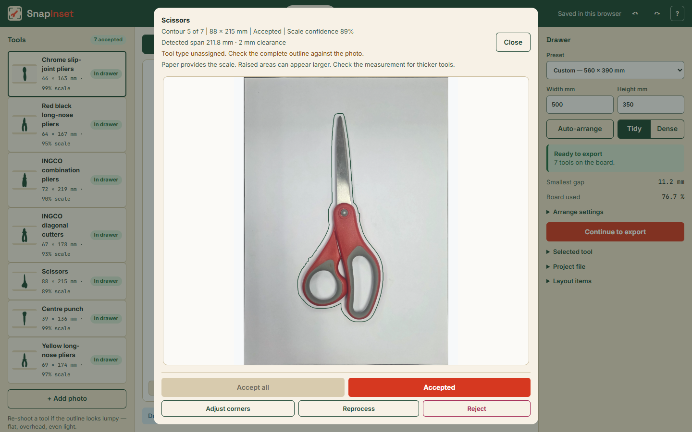

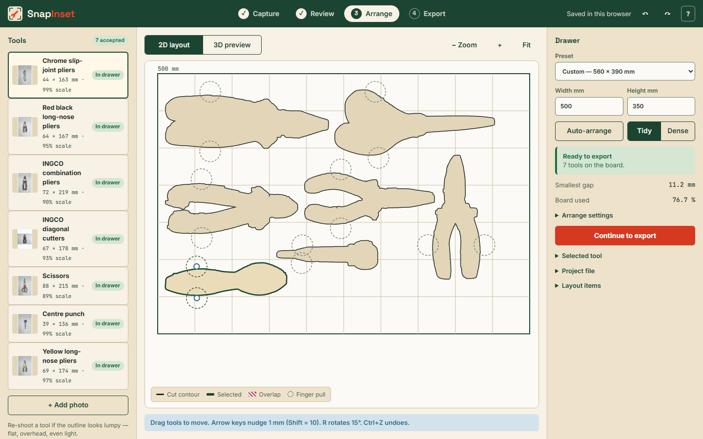

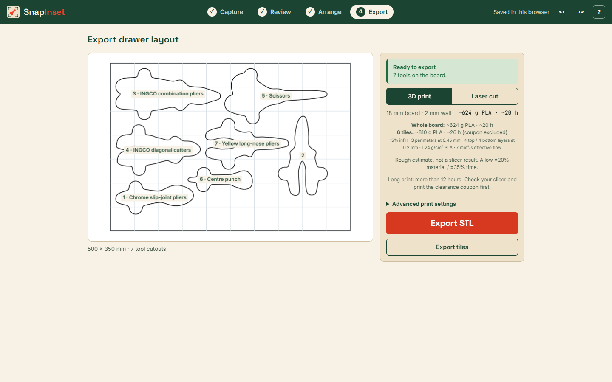

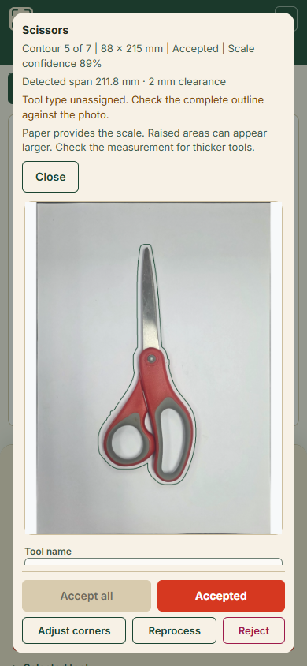

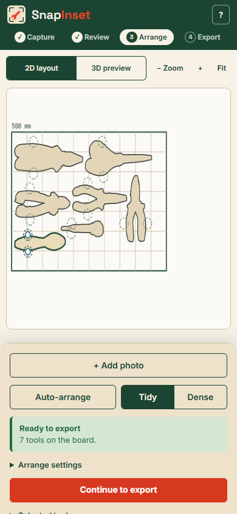

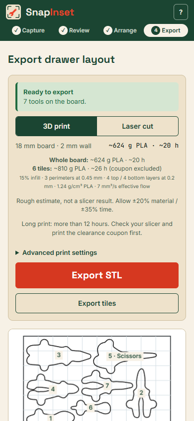

## Per-photo overlays

Green outlines are zero-clearance contours on the rectified paper.

### 1. Chrome slip-joint

20260629_111626.jpg

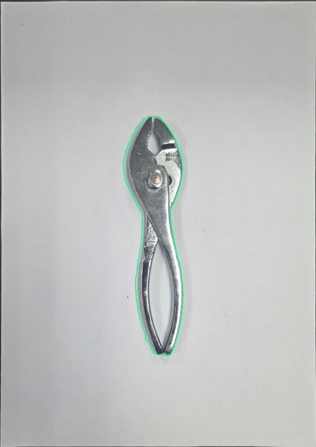

### 2. Red/black long-nose

20260629_111459.jpg

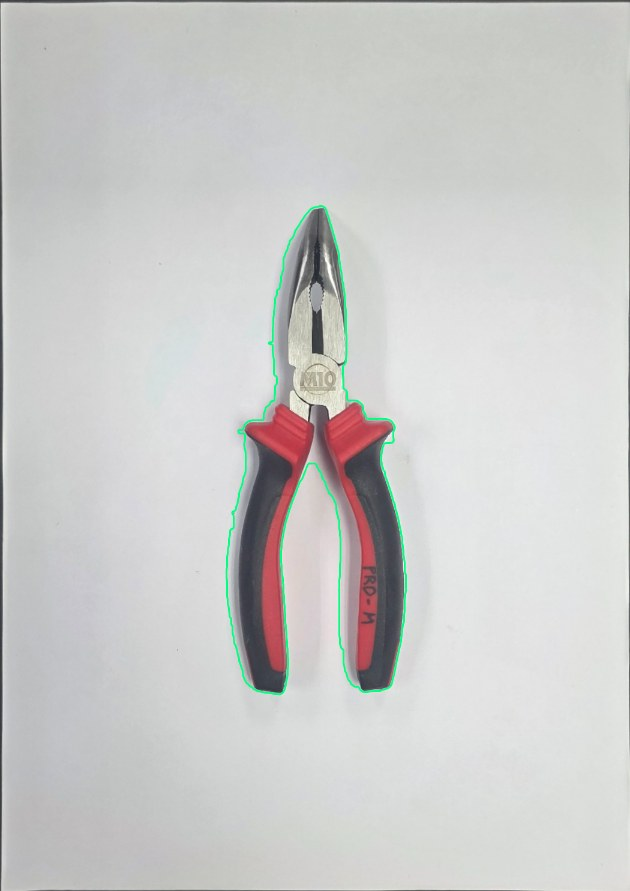

### 3. INGCO combination

20260629_111517.jpg

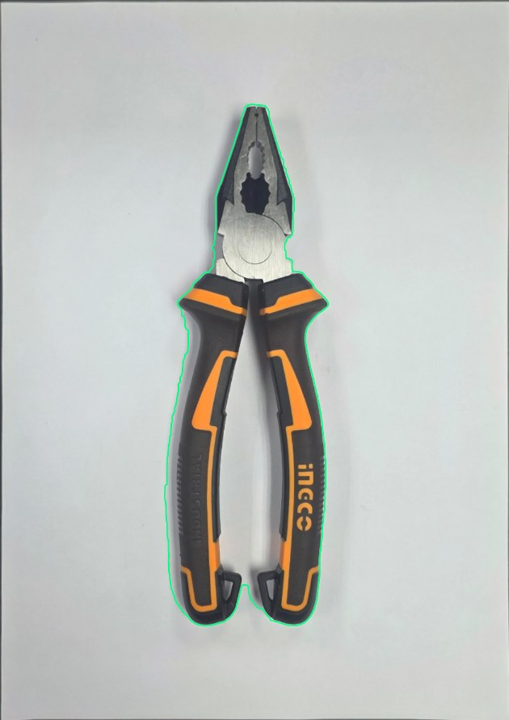

### 4. INGCO diagonal cutters

20260629_110314.jpg

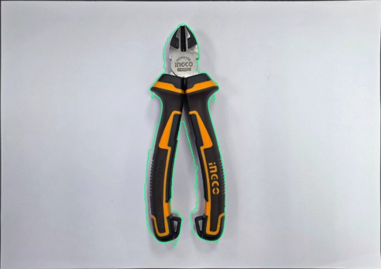

### 5. Red/grey scissors

20260629_111722.jpg

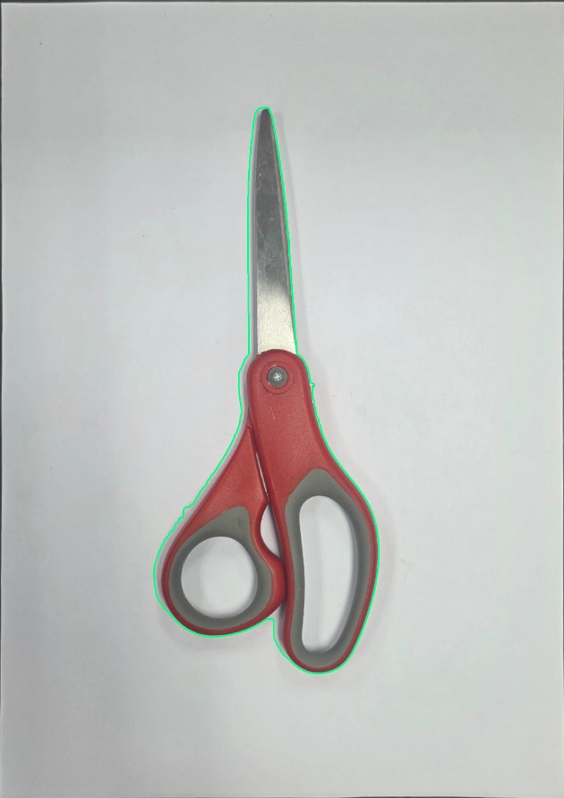

### 6. Blue centre punch

20260629_111912.jpg

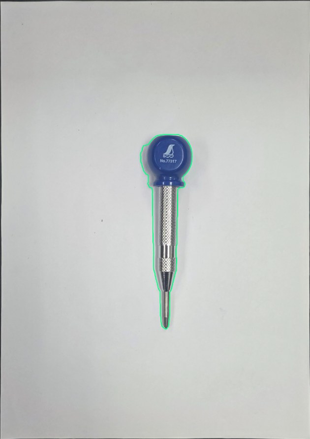

### 7. Yellow long-nose A

WhatsApp Image 2026-06-29 at 11.30.20 AM (1).jpeg

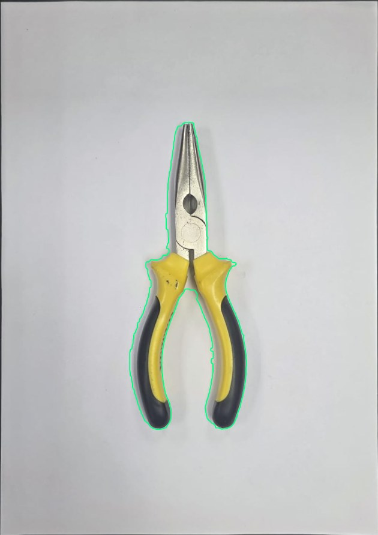

### 8. Yellow long-nose B

WhatsApp Image 2026-06-29 at 11.30.20 AM.jpeg

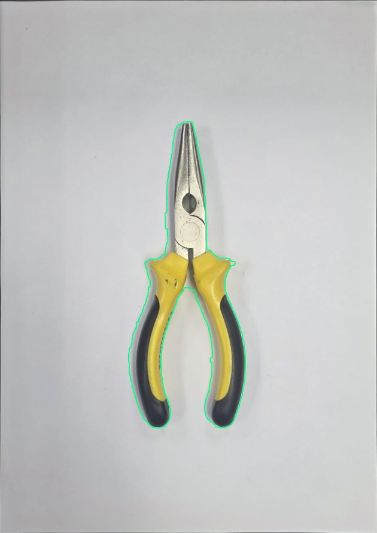

## Reproduce

Open outputs/index.html directly or serve the repository statically. Test-only dependencies: Node, Playwright and Chrome; Python trimesh/numpy/shapely for independent auditing. Set CHROME_PATH to Chrome and NODE_PATH if Playwright is installed outside the repository.

```text
node tests/print-regression.cjs
node tests/print-estimates.cjs
node tests/print-cache.cjs
node tests/capture-quality.cjs
node tests/segmentation-shadows.cjs
# PHOTOS_DIR: directory containing the eight original filenames
# OUTPUT_DIR: destination for exports, results and screenshots
node tests/photo-print-e2e.cjs
```

Evidence: [mesh audit](verification/manifold-independent.json), [orientation audit](verification/orientation-independent.json), [photo results](verification/photo-results.json), [shadow tests](verification/shadow-regression.json).
